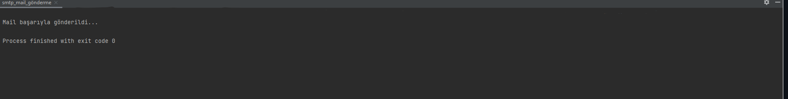

# How To Send Email With SMTP Modules In Python - Python'da SMTP Modülü ile Nasıl Email Gönderilir ?

## Built with 

- Python

- SMTPLib Library and SMTP Module

Note: Codes are working only in console. 

### For Download

You can clone my project.

###Console screen view

This project was developed in Python using the SMTPLib library and the SMTP module. The code runs exclusively in the console.

